  

  

  
  
  
  
  <!-- Ready-made email button. Put your email in, then remove the comment marks around the line:
  
  -->

 

  

  

 

  

  

 

  

  

  
  

 

  

  
  

 

  

  
  

 

  

  
  

 

  

  
  

 

  

  
  

 

  

  

 

  

  

 

  

  

 

  

  

  
  
  
  
  <!-- Ready-made email button. Put your email in, then remove the comment marks around the line:
  
  -->

  

