<!-- ══════════════════════════════  HERO  ══════════════════════════════ -->

  

   model -> working app" />

  
  
  
  <!-- Uncomment after you create your LinkedIn:
  
  -->

 

<!-- ══════════════════════════════  01 · WHO AM I  ══════════════════════════════ -->

  
   
  

 

<!-- ══════════════════════════════  02 · HOW I BUILD  ══════════════════════════════ -->

  
   
  

 

<!-- ══════════════════════════════  03 · PROJECTS  ══════════════════════════════ -->

  

<!-- ─────────── Project 01 · DevBot (FEATURED: put your strongest project here) ─────────── -->

  

  🧠 <b>How it works:</b> [ADD: model / API / method]
   
  📊 <b>Result:</b> [ADD: one number or proof, e.g. "answers N questions in ~X s"]
   
  🧰 <b>Built with:</b> [ADD: Python, ...]

<!-- Record a 5–10 s screen GIF of DevBot working, save it as assets/devbot-demo.gif, then uncomment:

  

-->

  
  

 

<!-- ─────────── Project 02 · Text Summarizer ─────────── -->

  

  🧠 <b>How it works:</b> [ADD: model or method]
   
  📊 <b>Result:</b> [ADD]

  
  

 

<!-- ─────────── Project 03 · Spam SMS Classifier ─────────── -->

  

  🧠 <b>How it works:</b> [ADD: e.g. TF-IDF + Naive Bayes]
   
  📊 <b>Result:</b> [ADD: XX% accuracy]

  
  

 

<!-- ─────────── Project 04 · Movie Recommender ─────────── -->

  

  🧠 <b>How it works:</b> [ADD: e.g. content-based filtering, cosine similarity]
   
  📊 <b>Result:</b> [ADD]

  
  

 

<!-- ─────────── Project 05 · Digit Recognizer ─────────── -->

  

  🧠 <b>How it works:</b> [ADD: e.g. CNN in Keras]
   
  📊 <b>Result:</b> [ADD: XX% accuracy on MNIST]

  
  

 

<!-- ══════════════════════════════  04 · TECH STACK  ══════════════════════════════ -->

  
   
  

 

<!-- ══════════════════════════════  05 · MISSION LOG  ══════════════════════════════ -->

  
   
  

  🌱 <b>Learning right now:</b> [ADD: e.g. deep learning, LLM apps]

 

<!-- ══════════════════════════════  06 · LIVE ACTIVITY  ══════════════════════════════ -->

  

<!-- These two cards are rebuilt every day by .github/workflows/stats.yml -->

  
   
  

<!-- Rebuilt every day by .github/workflows/snake.yml -->

  <picture>
    <source media="(prefers-color-scheme: dark)" srcset="https://raw.githubusercontent.com/mehtadeven/mehtadeven/output/github-snake-dark.svg" />
    <source media="(prefers-color-scheme: light)" srcset="https://raw.githubusercontent.com/mehtadeven/mehtadeven/output/github-snake.svg" />
    
  </picture>

 

<!-- ══════════════════════════════  07 · EDUCATION  ══════════════════════════════ -->

  
   
  

<!-- Keep only modules you have actually studied. Interviewers ask about what you list. -->

  <b>B.E. modules:</b> Machine Learning · Data Mining &amp; Visualization · Applied AI · Bio-inspired Optimization
   
  <b>Diploma modules:</b> Digital Signal Processing · Embedded Systems &amp; Edge AI · Control Systems

 

<!-- ══════════════════════════════  08 · LET'S CONNECT  ══════════════════════════════ -->

  

  <b>Hiring an AI/ML intern, or need a project built? Let's talk.</b>

  
  
  

  

