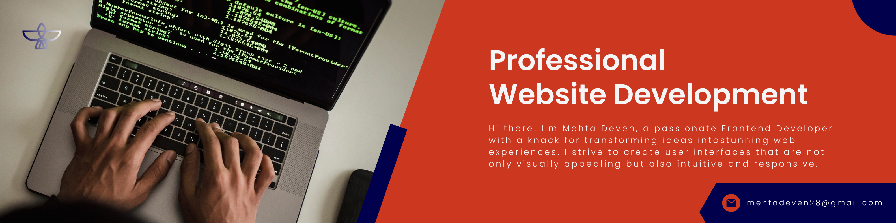

---

## Deven Mehta
**IT Student · AI/ML · Python · Building real projects**

<!-- Add this after you create your LinkedIn:

-->

🟢 **Open to AI/ML internships and freelance work** · based in Ahmedabad, India

---

## About
IT student at SAL College of Engineering, Ahmedabad. I build small AI/ML projects end to end, from data to a working app. Right now I am learning **[WHAT YOU ARE LEARNING NOW, e.g. deep learning, LLM apps]**.

---

## 🚀 Projects

| Project | What it does | Stack | Link |
|--------|--------------|-------|------|
| **Digit Recognizer** | [ONE LINE + RESULT, e.g. "Recognizes handwritten digits, 9X% accuracy on MNIST"] | `Python` `[ADD]` | [→ Repo](https://github.com/mehtadeven/REPO_NAME) |
| **Spam SMS Classifier** | [ONE LINE + RESULT, e.g. "Flags spam messages, 9X% accuracy"] | `Python` `[ADD]` | [→ Repo](https://github.com/mehtadeven/REPO_NAME) |
| **Movie Recommender** | [ONE LINE, e.g. "Suggests similar movies using ..."] | `Python` `[ADD]` | [→ Repo](https://github.com/mehtadeven/REPO_NAME) |
| **DevBot** | [ONE LINE, what the chatbot answers and how] | `[ADD]` | [→ Repo](https://github.com/mehtadeven/REPO_NAME) |
| **Text Summarizer** | [ONE LINE, which model or method] | `[ADD]` | [→ Repo](https://github.com/mehtadeven/REPO_NAME) |

---

## 🛠️ Tech Stack

**Languages**
`Python` `[ADD ONLY WHAT YOU CAN USE]`

**ML / AI**
`[e.g. scikit-learn]` `[e.g. TensorFlow or PyTorch]` `[ADD]`

**Tools**
`Git` `GitHub` `[ADD]`

---

## 🎓 Education

**B.Tech Information Technology** · SAL College of Engineering, Ahmedabad · *[GRADUATION YEAR]*

---

## 📱 Content

I am starting **@dev.builds** on Instagram, with Python and AI lessons. Launching soon.

---

## 🤝 Let's Connect

