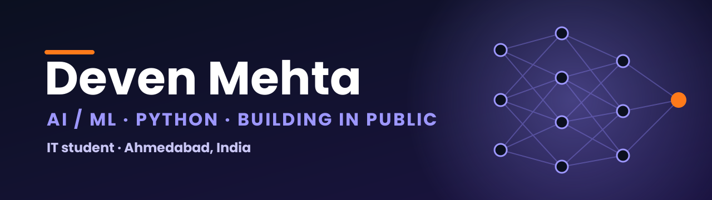

---

## Deven Mehta
**IT Student · AI/ML · Python · Building real projects**

<!-- Add this after you create your LinkedIn:

-->

🟢 **Open to AI/ML internships and freelance work** · based in Ahmedabad, India

---

## About
IT student at SAL College of Engineering, Ahmedabad. I build small AI/ML projects end to end, from data to a working app. Right now I am learning **[WHAT YOU ARE LEARNING NOW, e.g. deep learning, LLM apps]**.

---

## 🚀 Projects

| Project | What it does | Stack | Link |
|--------|--------------|-------|------|
| **Digit Recognizer** | [ONE LINE + RESULT, e.g. "Recognizes handwritten digits, 9X% accuracy on MNIST"] | `Python` `[ADD]` | [→ Repo](https://github.com/mehtadeven/REPO_NAME) |
| **Spam SMS Classifier** | [ONE LINE + RESULT, e.g. "Flags spam messages, 9X% accuracy"] | `Python` `[ADD]` | [→ Repo](https://github.com/mehtadeven/REPO_NAME) |
| **Movie Recommender** | [ONE LINE, e.g. "Suggests similar movies using ..."] | `Python` `[ADD]` | [→ Repo](https://github.com/mehtadeven/REPO_NAME) |
| **DevBot** | [ONE LINE, what the chatbot answers and how] | `[ADD]` | [→ Repo](https://github.com/mehtadeven/REPO_NAME) |
| **Text Summarizer** | [ONE LINE, which model or method] | `[ADD]` | [→ Repo](https://github.com/mehtadeven/REPO_NAME) |

---

## 🛠️ Technologies & Tools

### 💻 Programming Languages

### 🤖 Machine Learning & Deep Learning

### 🧠 Generative AI & NLP

### 📊 Data Science & Analytics

### ⚙️ Development Tools

## 🎓 Education

**B.E INFORMATION TECHNOLOGY** · SAL Engineering and Technical Institute · *2026-2029*
> Modules: Machine Learning · Data Mining & Visualization · Applied AI · Bio-inspired Optimization

**DIPLOMA INFORMATION TECHNOLOGY** · Gujarat Technological University· *2024-2026*
> Modules: Digital Signal Processing · Embedded Systems & Edge AI · Control Systems

---

## 🤝 Let's Connect

